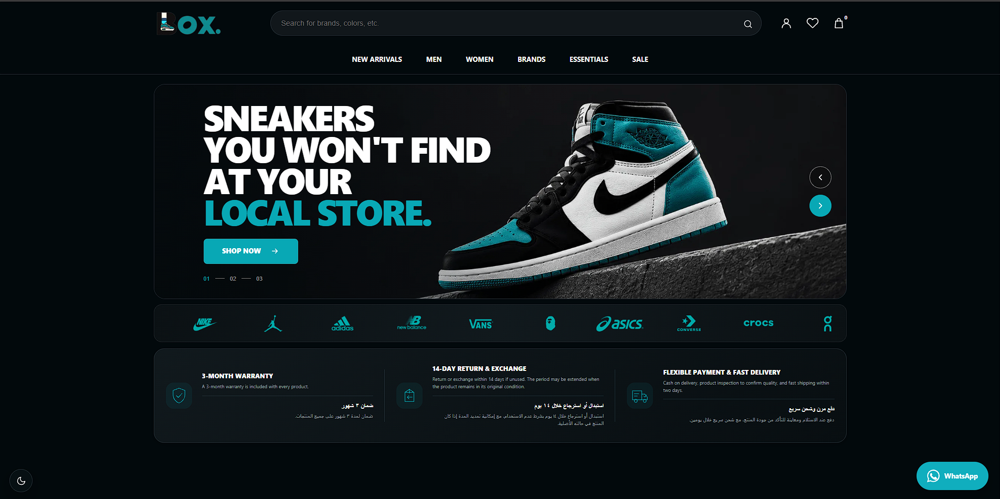

<div align="center">

# Box Sneakers Commerce Platform

### A custom, high-performance WooCommerce storefront built for a premium sneaker retailer.

[View Live Website](https://box-sneakers.com/)

</div>

---



## Project Overview

Box Sneakers is a production eCommerce platform designed for a sneaker and streetwear retailer operating in the Egyptian market.

The project involved rebuilding the customer-facing storefront with a custom WordPress and WooCommerce architecture focused on performance, maintainability, responsive behavior, and a premium shopping experience.

The platform supports both dark and light visual modes and delivers tailored experiences across desktop and mobile devices.

## Business Challenge

The store needed more than a visual redesign. The new platform had to:

- Deliver a distinctive premium brand experience.
- Perform reliably with a large product catalog and thousands of historical orders.
- Provide a smooth mobile-first shopping journey.
- Replace generic theme behavior with purpose-built WooCommerce components.
- Remain manageable for the internal operations team.
- Support future integrations and business automation.
- Run efficiently on production infrastructure.

## The Solution

A custom WooCommerce storefront was engineered around reusable components and a modular theme architecture.

The solution included:

- A fully custom WordPress theme.
- Custom WooCommerce layouts and components.
- Responsive desktop and mobile interfaces.
- Dark and light display modes.
- Custom navigation and mobile bottom navigation.
- Product discovery sections for arrivals, collections, brands, and best sellers.
- Wishlist, cart, account, and search experiences.
- Performance-focused infrastructure and caching.
- Production deployment and server optimization.

## Engineering Highlights

- Custom WooCommerce theme architecture
- Mobile-first responsive implementation
- Dark and light storefront modes
- Reusable UI component system
- Custom product cards and merchandising sections
- Optimized product listing experiences
- Redis object caching
- PHP OPcache configuration
- Nginx and PHP-FPM optimization
- MySQL-backed WooCommerce data layer
- Modular CSS and JavaScript structure
- Production deployment on Ubuntu
- Security hardening and backup workflows
- Git-based development workflow

## Core Experiences

### Product Discovery

The homepage presents multiple discovery paths including new arrivals, best sellers, collections, categories, and brand-based navigation.

### Responsive Commerce

The mobile interface was designed as a dedicated shopping experience rather than a reduced version of the desktop website.

It includes:

- Mobile search
- Category shortcuts
- Fixed bottom navigation
- Wishlist and cart access
- Mobile-optimized promotional sections
- Touch-friendly product browsing

### Theme Modes

The platform provides coordinated dark and light modes while maintaining the Box Sneakers brand colors and visual identity.

### Trust and Conversion

Key customer assurances are displayed directly within the shopping journey:

- Product warranty
- Return and exchange policy
- Flexible payment options
- Fast delivery
- WhatsApp customer support

## Technology Stack

| Layer | Technologies |
|---|---|
| Commerce | WordPress, WooCommerce |
| Backend | PHP, WooCommerce APIs |
| Frontend | HTML5, CSS3, JavaScript |
| Database | MySQL |
| Cache | Redis Object Cache, OPcache |
| Web Server | Nginx, PHP-FPM |
| Infrastructure | Ubuntu VPS |
| Workflow | Git, WP-CLI |

## System Architecture

```text
Customers
   │
   ├── Desktop Experience
   └── Mobile Experience
            │
            ▼
Custom WordPress Theme
            │
            ├── Reusable UI Components
            ├── Custom WooCommerce Templates
            ├── Product Discovery
            ├── Wishlist / Cart / Account
            └── Dark / Light Modes
            │
            ▼
WooCommerce Business Layer
            │
            ├── Products and Variations
            ├── Orders
            ├── Customers
            ├── Payments
            └── Inventory
            │
            ▼
Redis Cache ── MySQL ── PHP OPcache
            │
            ▼
Nginx + PHP-FPM on Ubuntu